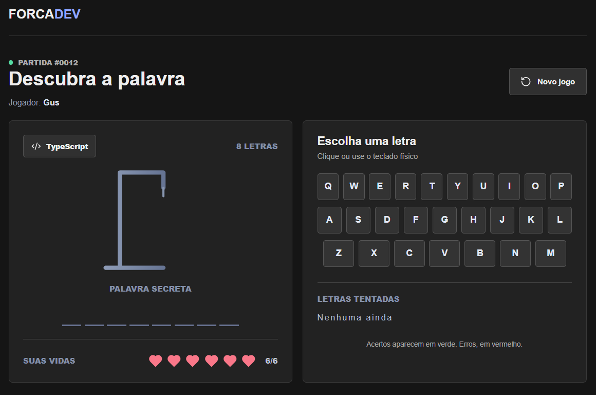

# Forca Dev

jogo da forca com palavras relacionadas à programação. o servidor sorteia uma palavra do banco de dados SQLite e o jogador tenta descobri-la chutando letras. a interface mostra o progresso da partida, e a palavra só é revelada quando o jogo termina.

## tecnologias utilizadas

**back-end:** Node.js, Express 5, TypeScript, SQLite (better-sqlite3), Zod, Vitest e Supertest.

**front-end:** React 19, Vite, TypeScript e Lucide React.

## pré-requisitos

- Node.js 22 LTS ou uma versão compatível.
- npm instalado.
- Visual Studio Code ou outro editor de código.

## como executar

primeiro, abra a pasta do projeto no VS Code.

### back-end

abra um terminal e execute:

```bash
cd backend
npm install
npm run seed
npm run dev
```

o servidor será iniciado em http://localhost:3333.

o comando `npm run seed` cadastra as palavras no banco de dados.

### front-end

abra outro terminal, a partir da pasta principal do projeto, e execute:

```bash
cd frontend
npm install
npm run dev
```

depois, abra http://localhost:5173 no navegador.

é necessário deixar os dois terminais funcionando para jogar.

## como jogar

1. digite um apelido de 3 a 20 caracteres.
2. clique em jogar para começar uma partida.
3. tente descobrir a palavra escolhendo letras no teclado.
4. cada letra errada faz perder uma vida.
5. o jogador começa com 6 vidas.
6. se descobrir a palavra, vence e recebe pontos.
7. se perder todas as vidas, a partida termina.
8. ao final, é possível jogar novamente e consultar o ranking.

## pontuação

os pontos são calculados apenas quando o jogador vence.

a fórmula utilizada é:

**pontos = vidas restantes × 10 + letras diferentes × 5**

caso o jogador perca, recebe 0 pontos.

o ranking mostra os 10 melhores resultados.

## testes

para executar os testes do projeto, abra um terminal na pasta principal e utilize:

```bash
cd backend
npm test
```

os testes verificam as regras do jogo e as respostas da API.

para verificar a compilação do back-end:

```bash
npm run build
```

para verificar a compilação do front-end, entre na pasta `frontend` e execute:

```bash
npm run build
```

## organização do projeto

- `backend/src/game`: regras do jogo.
- `backend/src/database`: banco de dados e cadastro das palavras.
- `backend/src/routes`: rotas da API.
- `backend/src/controllers`: recebimento das requisições.
- `backend/src/services`: funcionamento das partidas.
- `backend/src/repositories`: consultas ao banco de dados.
- `backend/tests`: testes automatizados.
- `frontend/src/components`: componentes da interface.
- `docs`: documentação do projeto.

## imagem do jogo



## documentação

na pasta `docs` estão os seguintes arquivos:

- `planejamento.md`: planejamento inicial do projeto.
- `api.md`: documentação das rotas da API.
- `decisoes.md`: decisões tomadas durante o desenvolvimento.
- `diario-de-bordo.md`: registro do desenvolvimento nas três aulas.

## uso de inteligência artificial

foi utilizada inteligência artificial como auxílio na implementação inicial do projeto, na criação e simplificação do design, na resolução de problemas e na revisão dos arquivos.